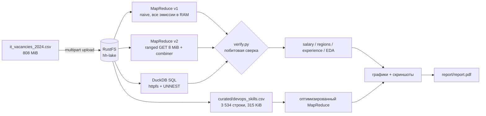
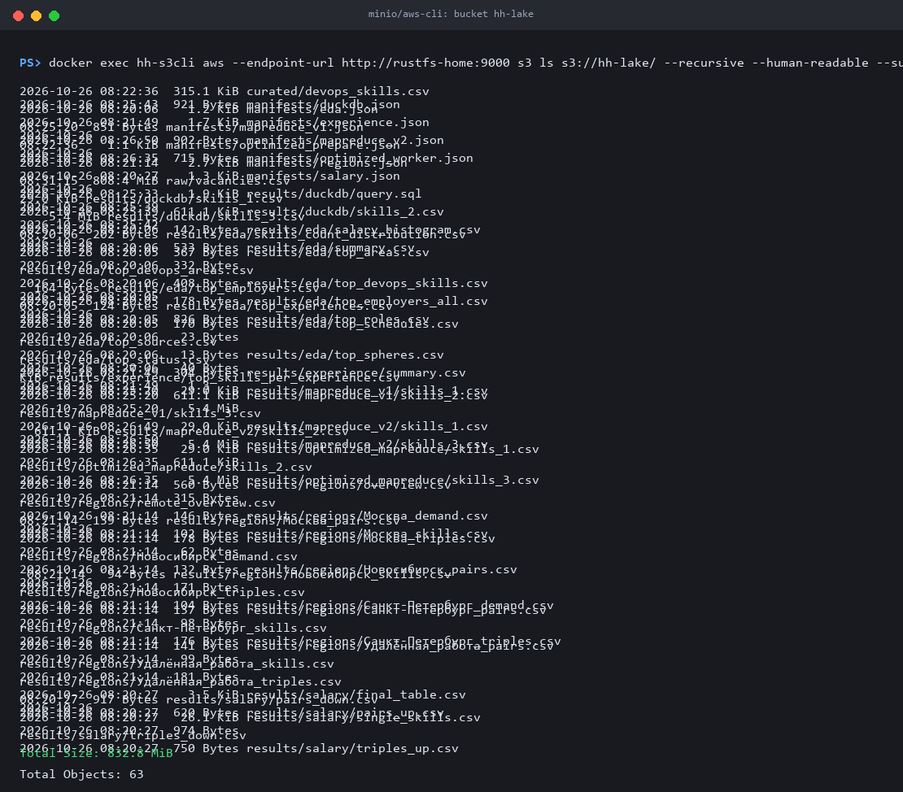
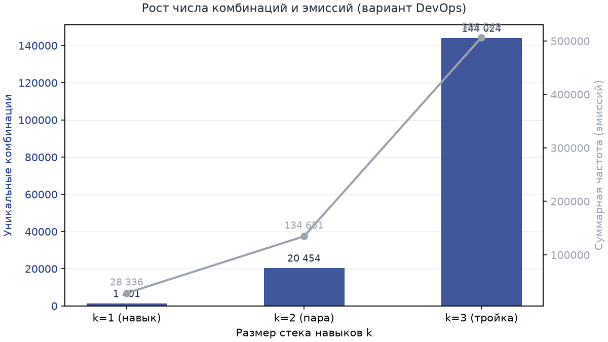
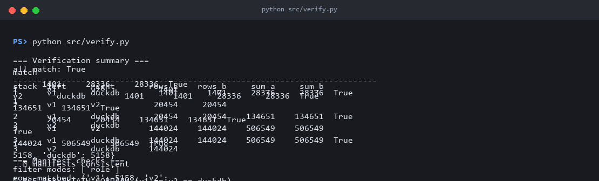
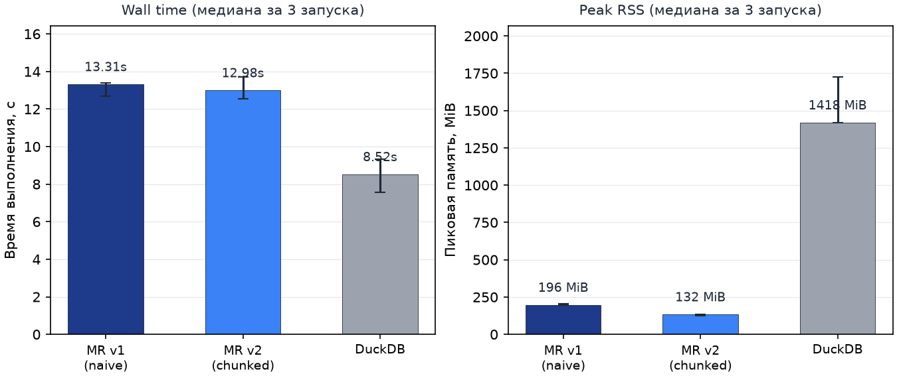
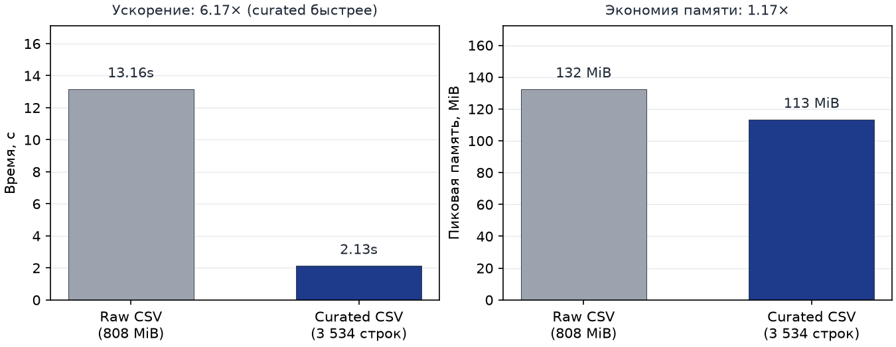
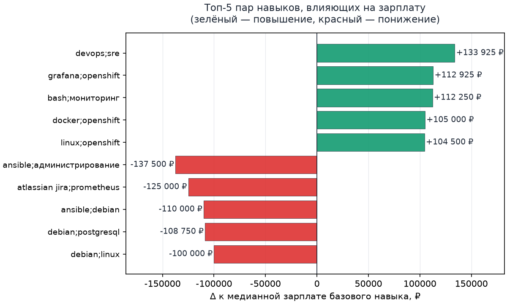
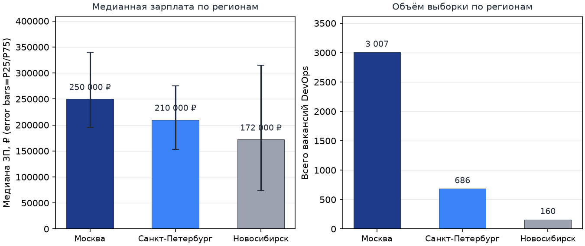
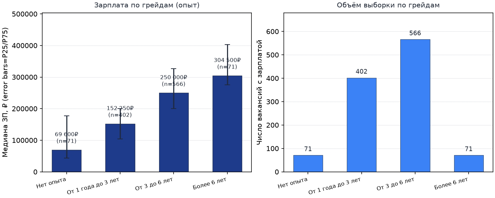
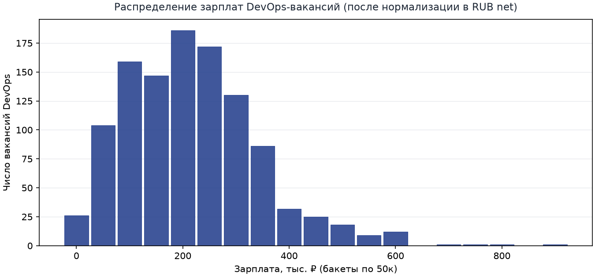

# HW3 Data Engineering — вариант DevOps

Аналитический пайплайн для датасета IT-вакансий: **RustFS (S3) → два независимых
MapReduce → DuckDB SQL → верификация → зарплаты/регионы/опыт/EDA →
профилирование времени и памяти → PDF-отчёт**.

Вариант — **DevOps**. Основной фильтр: `role == "DevOps-инженер"`.
Все числа ниже получены 26.10.2026 на локальной машине
(16 CPU, 15.34 GiB RAM, Python 3.14.5, Windows, RustFS на loopback).

---

## Ключевые результаты

| Показатель | Значение |
|---|---|
| Объект в хранилище | `s3://hh-lake/raw/vacancies.csv` |
| Размер | **847 619 384 B** (808.35 MiB), загрузка multipart 102 × 8 MiB |
| SHA-256 локального файла | `fb6a23f662c0b458e7d45d723862df5406cc25366164f4bb8246aad1cd4e83ef` |
| ETag объекта | `efb65458995932747001aa004592d19c-102` |
| Физических строк / валидных записей | 229 389 / **229 387** (1 пустая, 1 битая — 45 полей вместо 23) |
| DevOps-вакансий (role) | **5 158** |
| Из них с навыками | **3 534** |
| Уникальные навыки / пары / тройки | **1 401 / 20 454 / 144 024** |
| Суммарные частоты k = 1 / 2 / 3 | **28 336 / 134 651 / 506 549** |
| Совпадение v1 = v2 = DuckDB | **9 из 9 сравнений** |
| Медиана зарплаты (навыки + ЗП) | **210 000 ₽** (n = 787) |
| Профиль v1 / v2 / DuckDB | 13.31 с / 196 MiB · 12.99 с / 132 MiB · 8.52 с / 1 419 MiB |
| Бонус: raw → curated | **6.17× быстрее**, 1.17× меньше пиковой памяти |
| PDF-отчёт | [`report/report.pdf`](report/report.pdf) — 31 страница, 1.19 MiB |

---

## Архитектура



Расчёт навыков намеренно реализован **двумя независимыми способами**:

1. **MapReduce v1** (`src/mapreduce_v1.py`) — потоковое чтение объекта, но все
   эмиссии `(combine, 1)` материализуются в памяти. Это базовая «наивная»
   реализация для сравнения.
2. **MapReduce v2** (`src/mapreduce_v2.py`) — чтение объекта ranged-GET-запросами
   по 8 MiB. Границы чанков выравниваются по `\n`: неполная строка переносится
   в следующий чанк, строка длиннее чанка собирается целиком. Внутри чанка —
   дешёвый байтовый префильтр, затем точный разбор и частичный `Counter`.
3. **DuckDB SQL** (`src/duckdb_skills.py`) — тот же объект читается напрямую из
   S3 через `httpfs`; пары и тройки строятся самосоединением с `s1 < s2 < s3`.

`src/verify.py` сравнивает результаты попарно по каждому k: число строк,
сумму частот и построчное содержимое CSV, а также сверяет манифесты
(`rows_matched`, режим фильтра, `n_skills_k`).

---

## Быстрый старт

### Windows (PowerShell)

```powershell
docker compose up -d

python -m venv .venv
.venv\Scripts\python.exe -m pip install -r requirements.txt

# данные: положить it_vacancies_2024.csv в data/
.venv\Scripts\python.exe src\check_env.py
.venv\Scripts\python.exe src\run_all.py
```

### Linux / macOS

```bash
docker compose up -d
python3 -m venv .venv && source .venv/bin/activate
pip install -r requirements.txt
python src/check_env.py
python src/run_all.py
```

`run_all.py` выполняет шаги последовательно, пишет полные логи в
`report/logs/` и останавливается на первой ошибке. Флаги:
`--skip-upload` (объект уже загружен), `--skip-profile` (пропустить
профилирование и бенчмарк, ~10 минут).

Только отчёт по уже готовым данным:

```powershell
.venv\Scripts\python.exe src\make_report.py
```

### Ручной запуск по шагам

```powershell
.venv\Scripts\python.exe src\upload.py                     # raw/vacancies.csv
.venv\Scripts\python.exe src\mapreduce_v1.py               # v1
.venv\Scripts\python.exe src\mapreduce_v2.py               # v2
.venv\Scripts\python.exe src\duckdb_skills.py              # DuckDB
.venv\Scripts\python.exe src\verify.py                     # сверка
.venv\Scripts\python.exe src\eda.py                        # EDA
.venv\Scripts\python.exe src\analyze_salary.py             # пары/тройки → зарплата
.venv\Scripts\python.exe src\analyze_regions.py            # 3 региона + удалёнка
.venv\Scripts\python.exe src\analyze_experience.py         # грейды
.venv\Scripts\python.exe src\optimized_mapreduce.py prepare
.venv\Scripts\python.exe src\optimized_mapreduce.py verify
.venv\Scripts\python.exe src\profile.py                    # 3 запуска × 3 метода
.venv\Scripts\python.exe src\benchmark_optimization.py     # raw vs curated
.venv\Scripts\python.exe src\make_charts.py                # 9 PNG
.venv\Scripts\python.exe src\make_screenshots.py           # скриншоты команд
.venv\Scripts\python.exe src\make_report.py                # PDF
```

---

## Инфраструктура

`compose.yaml` поднимает два контейнера:

- `rustfs-home` — `rustfs/rustfs:1.0.0`, S3 API на `localhost:9010`,
  веб-консоль на `localhost:9011`, healthcheck `/health`;
- `s3cli` — `amazon/aws-cli:2.36.45` для проверок хранилища.

Бакет `hh-lake` создаётся клиентом автоматически. Загрузка — boto3
multipart по 8 MiB, 102 части; после загрузки выполняется `head_object`
и сверка размера с локальным файлом.

<p align="center">
  
</p>

Реальные снимки команд и веб-консоли RustFS лежат в
[`report/screenshots/`](report/screenshots/), полные логи —
в [`report/logs/`](report/logs/).

---

## Данные и фильтр варианта

Файл `it_vacancies_2024.csv` нестандартный: **первая физическая строка пустая,
заголовка нет**, а одна запись содержит 45 полей вместо 23. Поэтому все
читатели используют явную схему из 23 колонок и tolerant-разбор: пустые
строки, заголовок и строки с неверным числом полей пропускаются и считаются
отдельно.

```
source, vacancy_id, status, snapshot_date, published_at, area,
employer_id, employer_inn, employer_ogrn, employer_name, name, role,
sphere, salary_from, salary_to, currency, gross, experience, schedule,
employment, key_skills, description, url
```

| Метрика | Значение |
|---|---|
| Физических строк | 229 389 |
| Валидных записей | 229 387 |
| Пропущено пустых | 1 |
| Пропущено битых | 1 (`vacancy_id 106357315`, 45 полей) |
| Колонок | 23 |
| Уникальных `role` | 17 |
| Уникальных `area` | 1 643 |
| Уникальных `employer_id` | 31 796 |

`role` — это категория профессии, а не заголовок вакансии (заголовок в `name`),
поэтому строгий фильтр `role == "DevOps-инженер"` даёт чистый сегмент без
примеси соседних ролей. Режим переключается переменной
`VARIANT_FILTER_MODE=role|role_or_name|name`.

Для сравнения, широкий режим `role_or_name` даёт 7 786 вакансий, 5 335 с
навыками, 1 295 с зарплатой; уникальные k = 1/2/3 — 1 918 / 31 060 / 225 224,
суммы — 42 470 / 202 681 / 780 467. Все три реализации совпадают и в этом
режиме.

Нормализация навыков: `strip`, нижний регистр, Unicode NFC, удаление пустых
токенов и дублей внутри вакансии; комбинации внутри вакансии сортируются.
Зарплата приводится к месячной сумме в RUB net: середина диапазона
`salary_from`/`salary_to`, курсы USD 90 ₽, EUR 100 ₽, KZT 0.19 ₽,
gross уменьшается на 13 % НДФЛ.

---

## Результаты: навыки, пары, тройки

| k | Уникальных | Суммарная частота | Топ-5 комбинаций (частота) |
|---:|---:|---:|---|
| 1 | 1 401 | 28 336 | linux (2 190); kubernetes (1 862); docker (1 850); devops (1 319); ansible (1 252) |
| 2 | 20 454 | 134 651 | docker;kubernetes (1 251); docker;linux (1 208); kubernetes;linux (1 162); ansible;linux (871); devops;linux (842) |
| 3 | 144 024 | 506 549 | docker;kubernetes;linux (804); devops;docker;kubernetes (585); ansible;docker;kubernetes (552); ansible;docker;linux (546); devops;docker;linux (542) |

Сумма эмиссий v1: `28 336 + 134 651 + 506 549 = 669 536` — совпадает с
`emissions_total` в манифесте v1. Это независимая проверка того, что ни одна
вакансия не потеряна и не учтена дважды.

Рост комбинаторики объясняется формулой C(n, k) внутри вакансии: в среднем
8.02 навыка на вакансию с навыками, поэтому троек по вхождениям в 3.76 раза
больше пар, а уникальных троек — в 7.0 раз больше уникальных пар. Частые
комбинации (`docker/kubernetes/linux`) повторяются у многих вакансий и
«схлопываются» в одну строку результата.

<p align="center">
  
</p>

### Верификация

```text
stack  left     right       rows_a    rows_b     sum_a     sum_b  match
1      v1       v2            1401      1401     28336     28336  True
1      v1       duckdb        1401      1401     28336     28336  True
1      v2       duckdb        1401      1401     28336     28336  True
2      v1       v2           20454     20454    134651    134651  True
2      v1       duckdb       20454     20454    134651    134651  True
2      v2       duckdb       20454     20454    134651    134651  True
3      v1       v2          144024    144024    506549    506549  True
3      v1       duckdb      144024    144024    506549    506549  True
3      v2       duckdb      144024    144024    506549    506549  True

✓ ВСЕ РЕЗУЛЬТАТЫ СОВПАЛИ (v1 == v2 == duckdb)
```

<p align="center">
  
</p>

---

## Профилирование

Каждый метод запускался отдельным процессом: один прогревочный запуск
(исключён из статистики) и **три измерительных**, методы чередуются, чтобы
сгладить прогрев ОС и кэша. Wall time — monotonic-таймер вокруг процесса,
пиковая память — суммарный RSS дерева процессов (psutil, опрос каждые 20 мс).

| Метод | Wall, с (медиана) | Wall min–max | Peak RSS, MiB | Peak min–max |
|---|---:|---:|---:|---:|
| MapReduce v1 (naive) | 13.31 | 12.70–13.37 | 196.33 | 195.91–204.02 |
| MapReduce v2 (chunked) | 12.99 | 12.55–13.69 | 132.40 | 127.25–132.97 |
| DuckDB SQL | **8.52** | 7.55–9.32 | 1 418.50 | 1 418.37–1 723.26 |

- DuckDB быстрее по времени (1.53× против v2), но потребляет **в 10.7 раза
  больше памяти**: он читает весь CSV и держит агрегаты/кэш httpfs.
- v2 почти не быстрее v1 по времени (+2.5 %): узкое место — чтение 808 MiB и
  разбор 229 тыс. строк, а не reducer. Зато v2 **в 1.48 раза экономнее по
  памяти**, потому что агрегирует частичные `Counter` по чанкам и не хранит
  669 536 эмиссий.
- Абсолютные времена отражают локальный диск и loopback, а не облако.

<p align="center">
  
</p>

---

## Бонус: оптимизация через curated-витрину

Один раз фильтруем 808 MiB raw-файла в компактную витрину из двух колонок
(`vacancy_id`, нормализованные навыки) — 3 534 строки, 322 653 B (315 KiB),
в 2 627 раз меньше исходного объекта. Корректность витрины проверяется
построчно (`optimized_mapreduce.py verify`): 3 534 из 3 534 строк совпали,
расхождений и пропусков нет.

| Метод | Wall, с (медиана) | Peak RSS, MiB |
|---|---:|---:|
| MapReduce v2 (raw CSV) | 13.16 | 132.48 |
| MapReduce v2 (curated CSV) | **2.13** | **113.35** |

Итог: **6.17× быстрее** и **1.17× меньше пиковой памяти** при побитово том же
результате (число строк и суммы частот по k = 1, 2, 3). Главный выигрыш — не
читать 808 MiB и 23 колонки на каждом запуске.

<p align="center">
  
</p>

---

## Влияние навыков на зарплату

Из 5 158 DevOps-вакансий зарплата есть у 1 110, одновременно навыки и
зарплата — у 787. Медиана по выборке с навыками — **210 000 ₽**, по всем
зарплатным — 215 000 ₽. После порогов (пара ≥ 10 вакансий, тройка ≥ 8,
база ≥ 15) остаётся 582 пары и 2 880 троек. База для пары — более частый из
двух навыков, для тройки — более частая из трёх пар.

**Пары, повышающие зарплату**

| Пара | n | Медиана | База | Медиана базы | Δ |
|---|---:|---:|---|---:|---:|
| devops; sre | 12 | 350 175 ₽ | devops | 216 250 ₽ | **+133 925 ₽ (+61.9 %)** |
| grafana; openshift | 12 | 350 000 ₽ | grafana | 237 075 ₽ | +112 925 ₽ (+47.6 %) |
| bash; мониторинг | 10 | 327 250 ₽ | bash | 215 000 ₽ | +112 250 ₽ (+52.2 %) |
| docker; openshift | 12 | 322 500 ₽ | docker | 217 500 ₽ | +105 000 ₽ (+48.3 %) |
| linux; openshift | 13 | 304 500 ₽ | linux | 200 000 ₽ | +104 500 ₽ (+52.2 %) |
| git; gitlab ci | 19 | 300 000 ₽ | git | 195 750 ₽ | +104 250 ₽ (+53.3 %) |

**Пары, понижающие зарплату**

| Пара | n | Медиана | База | Медиана базы | Δ |
|---|---:|---:|---|---:|---:|
| ansible; администрирование | 11 | 112 500 ₽ | ansible | 250 000 ₽ | **−137 500 ₽ (−55.0 %)** |
| atlassian jira; prometheus | 10 | 125 000 ₽ | prometheus | 250 000 ₽ | −125 000 ₽ (−50.0 %) |
| ansible; debian | 11 | 140 000 ₽ | ansible | 250 000 ₽ | −110 000 ₽ (−44.0 %) |
| debian; postgresql | 11 | 130 500 ₽ | postgresql | 239 250 ₽ | −108 750 ₽ (−45.5 %) |
| debian; linux | 19 | 100 000 ₽ | linux | 200 000 ₽ | −100 000 ₽ (−50.0 %) |

**Тройки — лидеры роста:** `git; gitlab ci; python` — 360 000 ₽ против
180 000 ₽ у `git; python` (**+100 %**, n = 9), `git; gitlab ci; postgresql` —
+80 %, `ci/cd; python; zabbix` — +75 %. **Тройки — лидеры падения:**
`docker-compose; linux; prometheus` — −59.2 %, `jenkins; postgresql; sql` —
−56.9 %.

Интерпретация: вверх ведёт связка «CI/CD + IaC + автоматизация» (SRE,
OpenShift, Helm, Terraform, GitLab CI) — это признак зрелой платформенной
роли. Вниз — legacy-эксплуатация: Ansible/Debian в паре с тегами
«администрирование»/«debian», docker-compose, ручной мониторинг. Сами по себе
эти навыки востребованы; зарплату понижает контекст вакансии, а не технология.

Ограничение: n у топовых комбинаций 8–38, поэтому проценты индикативные;
устойчивее вывод о направлении, чем о конкретной величине прибавки.

<p align="center">
  
</p>

---

## Регионы

| Регион | Вакансий | С навыками | С ЗП | Медиана | P25 | P75 | Ср. навыков |
|---|---:|---:|---:|---:|---:|---:|---:|
| Москва | 3 007 | 2 015 | 573 | **250 000 ₽** | 195 750 ₽ | 340 000 ₽ | 7.65 |
| Санкт-Петербург | 686 | 488 | 161 | 210 000 ₽ | 153 000 ₽ | 275 000 ₽ | 8.34 |
| Новосибирск | 160 | 123 | 48 | 172 000 ₽ | 73 725 ₽ | 315 000 ₽ | 9.20 |
| Удалённая работа (отдельный срез) | 1 762 | 1 282 | 427 | 250 000 ₽ | 200 000 ₽ | 325 000 ₽ | 8.76 |

- Москва — 58.3 % выборки и медиана на 19 % выше Санкт-Петербурга и на 45 %
  выше Новосибирска.
- В Новосибирске широкий интервал (P25 73 725 ₽ — P75 315 000 ₽): город
  представлен и low-cost сопровождением, и высокооплачиваемыми
  удалёнными/продуктовыми командами.
- Среднее число навыков растёт от Москвы (7.65) к Санкт-Петербургу (8.34) и
  Новосибирску (9.20): в небольших городах вакансия чаще «широкая».
- Ядро стека одинаково: linux, docker, kubernetes, ansible. Акценты:
  Москва — yandex.cloud/istio/sonarqube, Санкт-Петербург — victoriametrics
  (×4.02)/windows server/powershell, Новосибирск — tcp/ip (×2.46)/aws/java.
- Удалёнка по медиане не уступает Москве (250 000 ₽), топ-навык — kubernetes.
  «Удалённая работа» хранится в `schedule`, а не в `area`; нормализация ё→е
  не теряет вариант «Удаленная работа».

<p align="center">
  
</p>

---

## Опыт и EDA

| Опыт | Вакансий | С навыками | Медиана | P25 | P75 | Ср. навыков |
|---|---:|---:|---:|---:|---:|---:|
| Нет опыта | 71 | 35 | 69 600 ₽ | 43 500 ₽ | 177 000 ₽ | 7.77 |
| От 1 года до 3 лет | 402 | 270 | 152 250 ₽ | 104 400 ₽ | 200 075 ₽ | 9.39 |
| От 3 до 6 лет | 566 | 426 | 250 000 ₽ | 200 000 ₽ | 326 250 ₽ | 8.87 |
| Более 6 лет | 71 | 56 | 304 500 ₽ | 275 000 ₽ | 402 500 ₽ | 8.27 |

Медиана монотонно растёт по грейдам (69 600 → 152 250 → 250 000 →
304 500 ₽), а число навыков почти не меняется: прибавка связана с уровнем
ответственности, а не с формальным расширением стека. Крайние группы
малочисленны (по 71 вакансии), поэтому интервалы широкие.

EDA по всему датасету: 229 387 валидных строк, 17 категорий `role`,
1 643 города, 31 796 работодателей. Топ-роли: программист/разработчик
(87 802), аналитик (30 112), системный администратор (29 723). Топ-города:
Москва (92 728), Санкт-Петербург (25 436), Екатеринбург (8 993).
`employer_name` в датасете пуст, поэтому работодатели считаются по
`employer_id` (лидер — 4 649 269, 168 DevOps-вакансий). Медиана числа
навыков на вакансию — 5.

<p align="center">
  
  
</p>

---

## Отчёт

[`report/report.pdf`](report/report.pdf) — **31 страница**, 1.19 MiB:
титульный лист, оглавление, ключевые результаты, методика, таблицы,
9 графиков, 7 скриншотов, выводы, приложения с фактическими логами команд
и инструкцией по воспроизводимости.

| Каталог | Содержимое |
|---|---|
| [`report/images/`](report/images/) | 9 PNG-графиков (рост комбинаций, профиль, зарплаты, регионы, оптимизация, EDA) |
| [`report/screenshots/`](report/screenshots/) | `docker compose ps`, бакет и `head-object`, вывод verify/profile/benchmark, веб-консоль RustFS |
| [`report/logs/`](report/logs/) | Полные логи каждого шага, включая `profile_*` по каждому прогону |
| `data/manifests/` | JSON-манифесты v1/v2/DuckDB/salary/regions/experience/EDA |
| `data/results_*` | CSV-результаты и SQL-запрос |

Скриншоты хранилища — реальные снимки команд и веб-консоли (генерируются
`src/make_screenshots.py`), а не рисунки.

---

## Тесты

```powershell
.venv\Scripts\python.exe -m unittest discover -s tests -v
```

14 тестов: схема из 23 полей, разбор валидных/пустых/битых строк, нормализация
навыков и зарплат, режимы фильтра, tolerant-ридер с UTF-8 на границах чанков,
отсутствие дублей и потерь строк при chunk_bytes от 1 до 8192, эквивалентность
v1 = v2 = DuckDB на синтетическом фикстуре. Тесты используют локальный
backend (`LOCAL_FS_ROOT`) и не требуют Docker.

---

## Переменные окружения

| Переменная | По умолчанию | Назначение |
|---|---|---|
| `S3_BACKEND` | `boto3` | `boto3` или `local` (для тестов) |
| `S3_ENDPOINT` | `http://localhost:9010` | S3 API RustFS |
| `S3_ACCESS_KEY` / `S3_SECRET_KEY` | `hhadmin` / `hhadmin-secret` | Креды |
| `S3_BUCKET` | `hh-lake` | Бакет |
| `VACANCIES_KEY` | `raw/vacancies.csv` | Ключ исходного объекта |
| `VARIANT_FILTER_MODE` | `role` | `role`, `role_or_name`, `name` |
| `REGIONS` | `Москва,Санкт-Петербург,Новосибирск` | Регионы сравнения |
| `READ_CHUNK_BYTES` | `8388608` | Размер чанка для v2 |
| `PROFILE_RUNS` | `3` | Число измерительных прогонов |

---

## Структура репозитория

```
.
├── compose.yaml                  # RustFS 9010/9011 + aws-cli
├── requirements.txt
├── TASK.md
├── src/
│   ├── common.py                 # S3-клиент, tolerant-ридер, фильтр, манифесты
│   ├── upload.py                 # multipart-загрузка CSV в RustFS
│   ├── mapreduce_v1.py           # наивный MapReduce
│   ├── mapreduce_v2.py           # чанки + prefilter + combiner
│   ├── duckdb_skills.py          # независимый SQL через httpfs
│   ├── verify.py                 # v1 == v2 == DuckDB
│   ├── eda.py                    # разведочный анализ
│   ├── analyze_salary.py         # пары/тройки → зарплата
│   ├── analyze_regions.py        # регионы + удалёнка
│   ├── analyze_experience.py     # грейды
│   ├── optimized_mapreduce.py    # curated prepare/verify/worker
│   ├── benchmark_optimization.py # raw vs curated
│   ├── profile.py                # 3 прогона × 3 метода, wall + peak RSS
│   ├── make_charts.py            # 9 графиков
│   ├── make_screenshots.py       # снимки реальных команд
│   ├── make_report.py            # PDF (ReportLab)
│   ├── check_env.py              # проверка окружения
│   └── run_all.py                # весь пайплайн с логами
├── tests/test_core.py            # 14 unit-тестов
├── data/                         # CSV/манифесты/результаты (raw CSV не в git)
└── report/                       # report.pdf, images, screenshots, logs
```

---

## Ограничения

- Все замеры локальные (RustFS на loopback); абсолютные времена не
  переносятся на облако, но контрольные числа детерминированы.
- Пиковая память — RSS дерева процессов, а не точный объём Python-кучи;
  у DuckDB в RSS входят буферы httpfs и кэш страниц.
- Зарплатные проценты — медианы по малым группам; они показывают направление
  и порядок, а не гарантированный эффект навыка.
- `employer_name` пуст, `key_skills` содержит не только технологии, но и теги
  роли (например, «администрирование», «английский язык»).

---

## Соответствие требованиям задания

| Требование | Где |
|---|---|
| Этап 1. RustFS | `compose.yaml`, [скриншоты](report/screenshots/) |
| Этап 2. Загрузка датасета | `src/upload.py`, лог `01_upload.log`, `head-object` |
| Этап 3. Навыки двумя способами | `src/mapreduce_v1.py`, `src/mapreduce_v2.py`, `src/duckdb_skills.py` |
| Точное совпадение результатов | `src/verify.py` — 9/9, лог `05_verify.log` |
| Пары и тройки + частота | `data/results_v2/skills_{1,2,3}.csv` |
| Влияние пар/троек на зарплату | `src/analyze_salary.py`, раздел «Зарплата» |
| Три региона | `src/analyze_regions.py`, раздел «Регионы» |
| Профилирование ≥ 3 запусков | `src/profile.py`, `data/results_profile/` |
| Wall time + peak memory | `summary.csv`, `12_profile.log`, график `02_profile.png` |
| PDF с выводами и скриншотами | [`report/report.pdf`](report/report.pdf) |
| Бонус: оптимизация | `optimized_mapreduce.py`, `benchmark_optimization.py` |
| Воспроизводимость | `src/run_all.py`, `src/check_env.py`, `tests/` |
